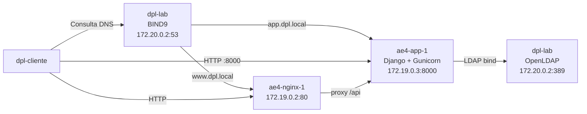

# AE6 — DNS y servicio de directorio para el despliegue

## 1. Objetivo

El objetivo de esta práctica es integrar resolución de nombres mediante BIND9 y autenticación mediante OpenLDAP en el despliegue de la aplicación AE4.

La solución final permite:

- Resolver `www.dpl.local` mediante DNS propio.
- Resolver `app.dpl.local` mediante DNS propio.
- Acceder al servidor web nginx mediante nombre.
- Acceder al servidor de aplicaciones Django/Gunicorn mediante nombre.
- Autenticar usuarios de la aplicación contra OpenLDAP.
- Verificar credenciales LDAP correctas e incorrectas.
- Automatizar las comprobaciones mediante `scripts/comprobar.sh`.

---

## 2. Arquitectura



### Direcciones utilizadas

| Servicio | Dirección |
|---|---|
| `dpl-lab` | `172.20.0.2` |
| `dpl-cliente` en `dpl-net` | `172.20.0.3` |
| `ae4-nginx-1` | `172.19.0.2` |
| `ae4-app-1` | `172.19.0.3` |
| `ae4-app-1` en `dpl-net` | `172.20.0.4` |

---

# 3. Redes Docker

Se utiliza la red:

```text
dpl-net
```

para la comunicación entre:

- `dpl-lab`
- `dpl-cliente`
- `ae4-app-1`

El contenedor de la aplicación también permanece conectado a:

```text
ae4_default
```

para comunicarse con el resto de servicios del proyecto AE4.

La aplicación se añadió de forma persistente a `dpl-net` en `compose.yml`.

Configuración añadida al servicio `app`:

```yaml
networks:
  - default
  - dpl-net
```

Y al final de `compose.yml`:

```yaml
networks:
  dpl-net:
    external: true
```

---

# 4. Configuración DNS

## 4.1 Instalación de BIND9

BIND9 se instaló dentro del contenedor `dpl-lab`:

```bash
apt update
apt install -y bind9 bind9utils bind9-dnsutils
```

El contenedor no utiliza systemd, por lo que `named` se ejecuta manualmente.

```bash
named -g
```

Se comprobó su ejecución mediante:

```bash
pgrep -a named
```

y el puerto 53 mediante:

```bash
ss -lunp | grep ':53'
```

---

## 4.2 Declaración de la zona

Archivo:

```text
/etc/bind/named.conf.local
```

Contenido:

```conf
zone "dpl.local" {
    type master;
    file "/etc/bind/db.dpl.local";
};
```

---

## 4.3 Zona `dpl.local`

Archivo:

```text
/etc/bind/db.dpl.local
```

Configuración final:

```dns
$TTL 604800

@   IN  SOA ns.dpl.local. admin.dpl.local. (
        2026111703
        604800
        86400
        2419200
        604800
)

@       IN  NS  ns.dpl.local.

ns      IN  A   172.20.0.2
www     IN  A   172.19.0.2
app     IN  A   172.19.0.3
```

Los registros representan:

- `ns.dpl.local` → servidor DNS `dpl-lab`.
- `www.dpl.local` → servidor web nginx.
- `app.dpl.local` → servidor Django/Gunicorn.

Cada vez que se modificó la zona se incrementó el serial.

---

## 4.4 Validación de BIND9

Se utilizaron:

```bash
named-checkconf
```

y:

```bash
named-checkzone dpl.local /etc/bind/db.dpl.local
```

La zona final fue validada correctamente:

```text
zone dpl.local/IN: loaded serial 2026111703
OK
```

---

# 5. Configuración del cliente DNS

Inicialmente `dpl-cliente` utilizaba el DNS interno de Docker:

```text
nameserver 127.0.0.11
```

Para resolver directamente la zona `dpl.local`, se configuró como servidor principal:

```text
nameserver 172.20.0.2
nameserver 127.0.0.11
```

La resolución se verificó sin añadir entradas de `dpl.local` en `/etc/hosts`.

Comprobación:

```bash
grep dpl.local /etc/hosts || echo "sin entradas locales (correcto)"
```

Resultado:

```text
sin entradas locales (correcto)
```

---

# 6. Pruebas DNS

Se realizaron las siguientes pruebas desde `dpl-cliente`:

```bash
dig @172.20.0.2 www.dpl.local A
```

Resultado final:

```text
www.dpl.local -> 172.19.0.2
```

También:

```bash
dig @172.20.0.2 app.dpl.local A +short
```

Resultado:

```text
172.19.0.3
```

Se verificó además mediante:

```bash
nslookup www.dpl.local
```

```bash
host -t a www.dpl.local
```

```bash
ping -c 3 www.dpl.local
```

Las salidas completas se encuentran en:

```text
comprobaciones.txt
```

---

# 7. Acceso por nombre

## Servidor Web

Desde `dpl-cliente`:

```bash
curl -I http://www.dpl.local
```

Resultado:

```text
HTTP/1.1 200 OK
Server: nginx/1.27.5
```

## Servidor de aplicaciones

Se probó:

```bash
curl -v http://app.dpl.local:8000/api/mensaje
```

Resultado:

```text
HTTP/1.1 200 OK
Server: gunicorn
```

La aplicación devolvió correctamente una respuesta JSON.

---

# 8. OpenLDAP

## 8.1 Instalación

Dentro de `dpl-lab` se instalaron:

```bash
apt install -y slapd ldap-utils
```

La base configurada es:

```text
dc=dpl,dc=local
```

La configuración fue comprobada mediante:

```bash
slapcat
```

---

## 8.2 Arranque

Al no disponer de systemd en el contenedor, `slapd` se lanzó manualmente:

```bash
slapd -d 0 -h ldap:/// &
```

Se verificó mediante:

```bash
pgrep -a slapd
```

y:

```bash
ss -lntp | grep ':389'
```

El servicio quedó escuchando correctamente en el puerto 389.

---

# 9. Estructura LDAP

La estructura creada es:

```text
dc=dpl,dc=local
└── ou=usuarios
    ├── uid=alumno
    └── uid=maria
```

El fichero entregado es:

```text
ldif/usuarios.ldif
```

Las contraseñas reales utilizadas durante las pruebas no se incluyen en dicho fichero.

Se utiliza:

```text
CAMBIAR_ESTO
```

como valor de ejemplo.

---

# 10. Comprobación del directorio

Se utilizó:

```bash
ldapsearch -x -LLL \
-b "dc=dpl,dc=local" \
"(objectClass=inetOrgPerson)" \
dn uid
```

Se verificaron los usuarios:

```text
uid=alumno,ou=usuarios,dc=dpl,dc=local
uid=maria,ou=usuarios,dc=dpl,dc=local
```

También se comprobó el contenido mediante:

```bash
slapcat
```

---

# 11. Autenticación LDAP

## Credenciales correctas

Se realizó un bind LDAP con el usuario `alumno`.

```bash
ldapwhoami -x \
-H ldap://172.20.0.2 \
-D "uid=alumno,ou=usuarios,dc=dpl,dc=local" \
-w <CONTRASEÑA_DE_PRUEBA>
```

Resultado:

```text
dn:uid=alumno,ou=usuarios,dc=dpl,dc=local
```

## Credenciales incorrectas

```bash
ldapwhoami -x \
-H ldap://172.20.0.2 \
-D "uid=alumno,ou=usuarios,dc=dpl,dc=local" \
-w incorrecta
```

Resultado:

```text
ldap_bind: Invalid credentials (49)
```

Esto confirma que el directorio acepta las credenciales válidas y rechaza las incorrectas.

---

# 12. Integración de la aplicación con LDAP

La aplicación AE4 utiliza las siguientes variables:

```yaml
LDAP_HOST: "ldap://dpl-lab"
LDAP_BASE_DN: "ou=usuarios,dc=dpl,dc=local"
LDAP_USER_FILTER: "(uid=%s)"
```

El contenedor `ae4-app-1` está conectado tanto a:

```text
ae4_default
```

como a:

```text
dpl-net
```

De esta manera puede acceder tanto a los servicios de AE4 como al servidor LDAP.

---

# 13. Login de la aplicación

## Login válido

Petición:

```bash
curl -i -X POST \
-d "usuario=alumno&password=<CONTRASEÑA_DE_PRUEBA>" \
http://www.dpl.local/api/login
```

Resultado:

```text
HTTP/1.1 200 OK
```

Respuesta de la aplicación:

```json
{
  "autenticado": true,
  "usuario": "alumno",
  "perfil": {
    "cn": "Alumno",
    "mail": []
  }
}
```

## Login inválido

```bash
curl -i -X POST \
-d "usuario=alumno&password=incorrecta" \
http://www.dpl.local/api/login
```

Resultado:

```text
HTTP/1.1 401 Unauthorized
```

La aplicación devuelve:

```json
{
  "autenticado": false,
  "usuario": "alumno",
  "detalle": "automatic bind not successful - invalidCredentials"
}
```

---

# 14. Comprobación automática

Se ha creado:

```text
scripts/comprobar.sh
```

El script comprueba automáticamente:

- configuración BIND9;
- zona `dpl.local`;
- proceso `named`;
- resolución de `www.dpl.local`;
- resolución de `app.dpl.local`;
- proceso `slapd`;
- existencia del usuario `alumno`;
- bind LDAP correcto;
- rechazo del bind incorrecto;
- acceso Web por nombre;
- login correcto de la aplicación;
- rechazo del login incorrecto.

Ejecución:

```bash
USER_PASSWORD=<CONTRASEÑA_DE_PRUEBA> ./scripts/comprobar.sh
```

Resultado final:

```text
Resultado: todas las comprobaciones han pasado.
```

El script devuelve código distinto de cero si alguna prueba falla.

---

# 15. Problemas encontrados y soluciones

## Problema 1 — BIND9 no estaba instalado

### Síntoma

```bash
which named
```

no devolvía ningún ejecutable.

### Causa

El contenedor `dpl-lab` no tenía instalado BIND9.

### Corrección

```bash
apt update
apt install -y bind9 bind9utils bind9-dnsutils
```

### Verificación

```bash
named -v
```

BIND9 quedó correctamente instalado.

---

## Problema 2 — `dpl-cliente` no utilizaba nuestro DNS

### Síntoma

Las consultas indicando explícitamente el servidor funcionaban:

```bash
dig @172.20.0.2 www.dpl.local
```

pero:

```bash
host www.dpl.local
```

y:

```bash
ping www.dpl.local
```

fallaban.

### Causa

`/etc/resolv.conf` utilizaba:

```text
nameserver 127.0.0.11
```

en lugar del BIND9 de `dpl-lab`.

### Corrección

Se configuró:

```text
nameserver 172.20.0.2
nameserver 127.0.0.11
```

### Verificación

```bash
host -t a www.dpl.local
```

y:

```bash
ping -c 3 www.dpl.local
```

resolvieron correctamente.

---

## Problema 3 — Registros A apuntando a IP incorrecta

### Síntoma

Inicialmente:

```bash
curl http://www.dpl.local
```

intentaba conectarse a:

```text
172.20.0.2:80
```

y devolvía:

```text
Connection refused
```

### Causa

El registro A de `www.dpl.local` apuntaba a `dpl-lab` y no al servidor nginx.

También fue necesario corregir el registro de `app.dpl.local`.

### Corrección

Configuración final:

```dns
www     IN A    172.19.0.2
app     IN A    172.19.0.3
```

Se incrementó el serial de la zona.

### Verificación

```bash
dig @172.20.0.2 www.dpl.local A +short
```

Resultado:

```text
172.19.0.2
```

Y:

```bash
curl -I http://www.dpl.local
```

Resultado:

```text
HTTP/1.1 200 OK
```

---

## Problema 4 — slapd no estaba arrancado

### Síntoma

Al importar el LDIF:

```text
ldap_sasl_bind(SIMPLE): Can't contact LDAP server (-1)
```

### Causa

El servicio `slapd` no se encontraba ejecutándose.

### Comprobación

```bash
pgrep -a slapd
```

y:

```bash
ss -lntp | grep ':389'
```

no mostraban servicio activo.

### Corrección

```bash
slapd -d 0 -h ldap:/// &
```

### Verificación

```bash
pgrep -a slapd
```

y:

```bash
ss -lntp | grep ':389'
```

mostraron `slapd` activo y escuchando en el puerto 389.

---

## Problema 5 — Aplicación sin configuración LDAP

### Síntoma

El endpoint:

```text
/api/login
```

devolvía:

```text
HTTP/1.1 503 Service Unavailable
```

con:

```json
{
  "error": "Directorio no configurado",
  "detalle": "Define LDAP_HOST para habilitar /api/login"
}
```

### Causa

El contenedor `ae4-app-1` no tenía definidas las variables de entorno LDAP.

Además, inicialmente la aplicación no compartía la red `dpl-net` con el servidor LDAP.

### Corrección

Se añadieron a `compose.yml`:

```yaml
LDAP_HOST: "ldap://dpl-lab"
LDAP_BASE_DN: "ou=usuarios,dc=dpl,dc=local"
LDAP_USER_FILTER: "(uid=%s)"
```

y la red:

```yaml
networks:
  - default
  - dpl-net
```

Se declaró:

```yaml
networks:
  dpl-net:
    external: true
```

Finalmente se recreó el servicio:

```bash
docker compose up -d --force-recreate app
```

### Verificación final

Con credenciales correctas:

```text
HTTP/1.1 200 OK
```

Con contraseña incorrecta:

```text
HTTP/1.1 401 Unauthorized
```

La autenticación contra OpenLDAP funciona correctamente.

---

# 16. Evidencias

Las salidas reales de las comprobaciones se encuentran en:

```text
comprobaciones.txt
```

También se ha generado un fichero auxiliar con salidas reales durante el desarrollo:

```text
comprobaciones_reales.txt
```

La entrega final conserva únicamente los ficheros solicitados.

---

# 17. Estructura de entrega

```text
ae6/
├── README.md
├── comprobaciones.txt
├── dns/
│   ├── named.conf.local
│   └── dpl.local.db
├── ldif/
│   └── usuarios.ldif
└── scripts/
    └── comprobar.sh
```

Además se incluye:

```text
.git/
```

con el historial de cambios correspondiente.

---

# 18. Repositorio remoto

Repositorio:

```text
PEGAR_AQUÍ_URL_DEL_REPOSITORIO
```

---

# 19. Resultado final

Se ha verificado la cadena completa:

```text
dpl-cliente
    ↓
BIND9
    ↓
www.dpl.local / app.dpl.local
    ↓
nginx
    ↓
Django / Gunicorn
    ↓
OpenLDAP
```

La resolución DNS, acceso Web, aplicación y autenticación contra el directorio funcionan correctamente.
